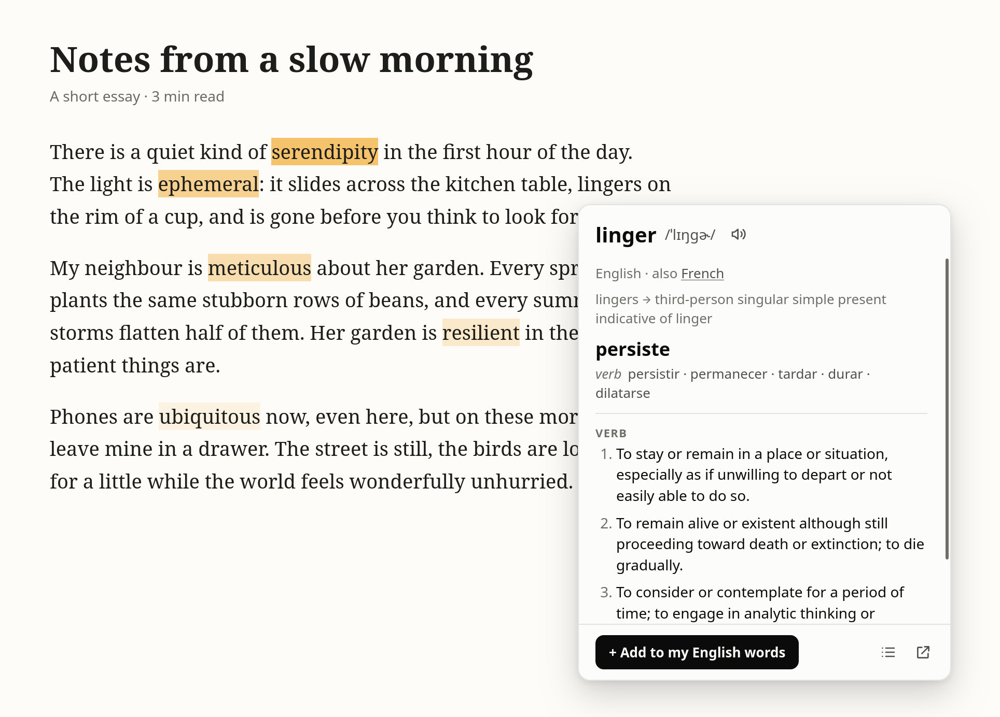
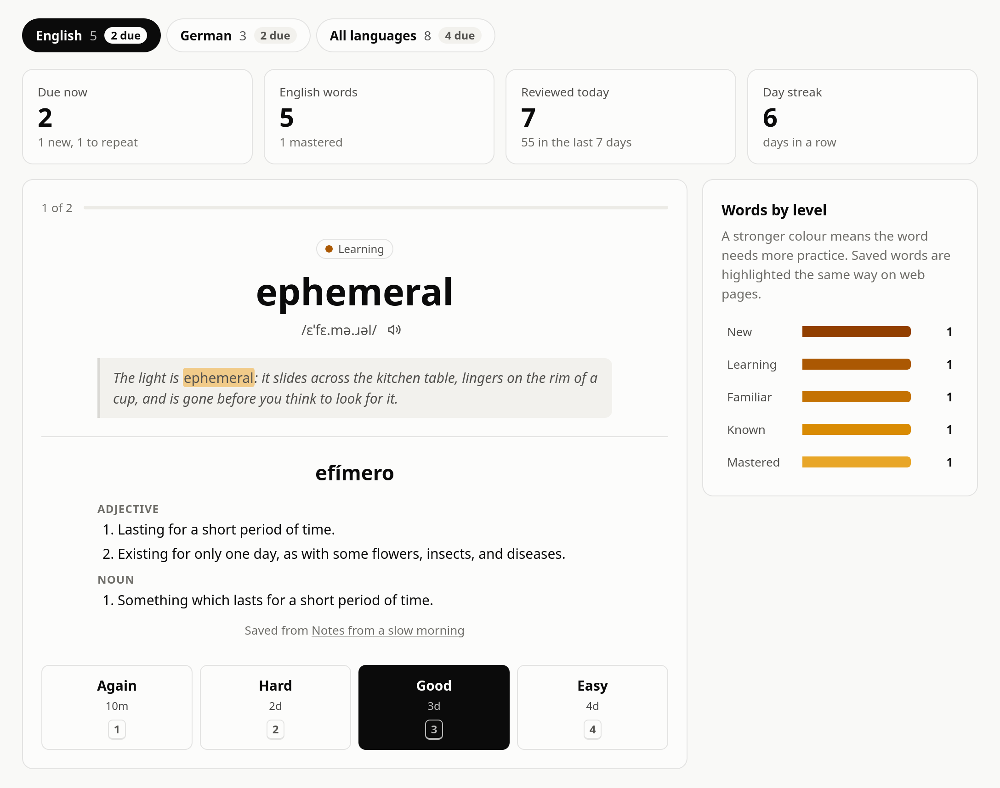
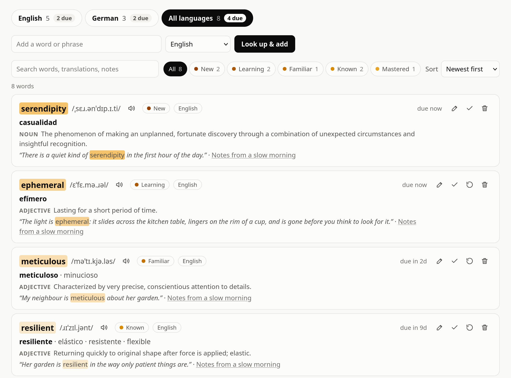
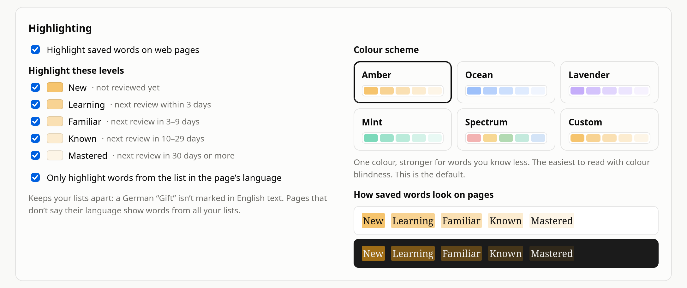
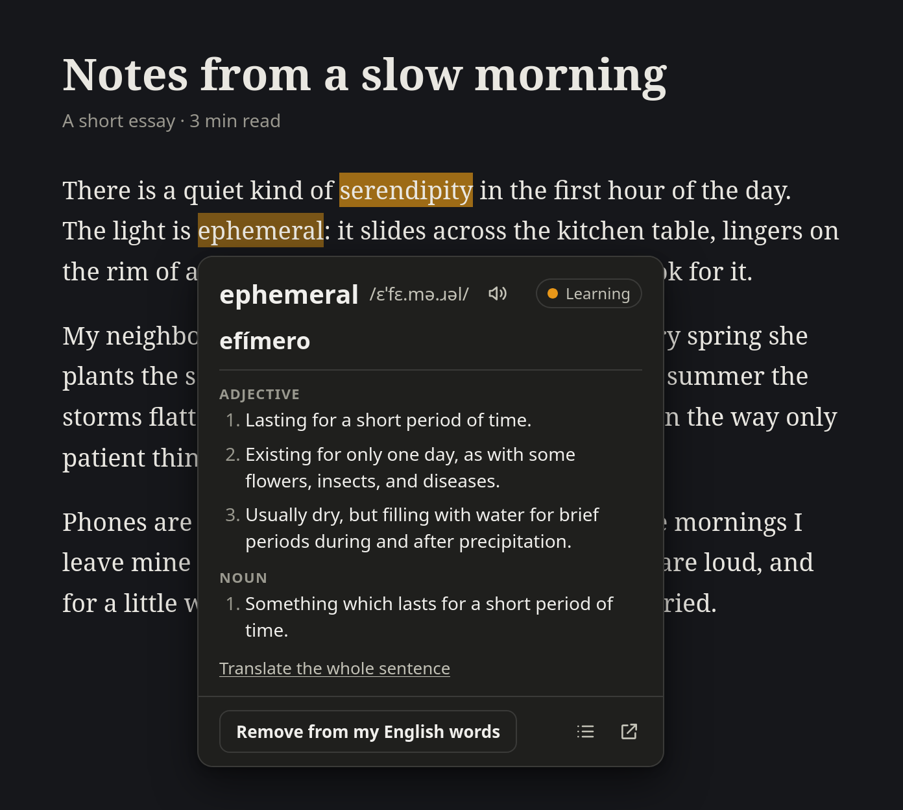

  

<h1 align="center">Wover</h1>

  <b>Hold a key, point at a word, learn it.</b> 
  A Firefox extension for learning vocabulary while you read.

  
  
  

  

## ✨ Features

- 🔍 Hold <kbd>Ctrl</kbd> and point at a word to see its definition, pronunciation and translation
- ➕ Save words with one click, together with the sentence you found them in
- 🖍️ Saved words are highlighted on every page, more strongly the less you know them
- 🧠 Review them with spaced-repetition flashcards
- 🌍 Keep a separate list for each language
- 🎨 Pick a colour scheme and a light, dark or system theme
- 💾 Back up, restore and export your words
- 🔒 Your words stay in your browser

## 📸 Screenshots

| Review | Word lists |
| --- | --- |
|  |  |

| Colour schemes | Dark mode |
| --- | --- |
|  |  |

## 📦 Installation

### Firefox Add-ons (coming soon)

### From source

1. Download this repository (**Code → Download ZIP**, then unzip it) or run `git clone https://github.com/AEA1212/wover.git`.
2. In Firefox, open `about:debugging#/runtime/this-firefox`.
3. Click **Load Temporary Add-on…** and choose `manifest.json`.

⚠️ Firefox removes temporary add-ons when it restarts, so repeat step 3 after each restart.

## 🚀 How to use

1. Choose the language you want translations in (the settings open when you install Wover).
2. On any web page, hold <kbd>Ctrl</kbd> and point at a word.
3. Click **+ Add to my … words**.
4. Click the Wover button in the toolbar to review your words.

⚠️ Wover can't run on Firefox's own pages, in Reader View or in the PDF viewer.

## 🔒 Privacy

Your words and settings are stored only in Firefox. When you look a word up, only that word (or a sentence you ask to translate) is sent to Wiktionary and to a translation service (Google Translate or MyMemory).

---

  ⚠️ Mostly vibe coded and still a prototype, so it may have bugs. Back up your words now and then, and please report problems in <a href="../../issues">Issues</a>.

